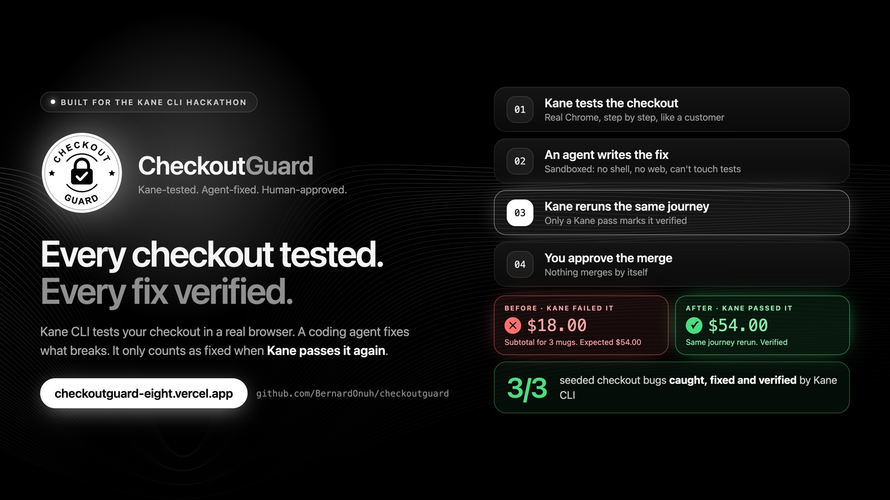
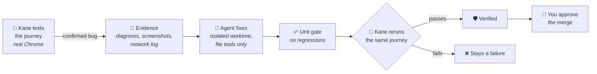
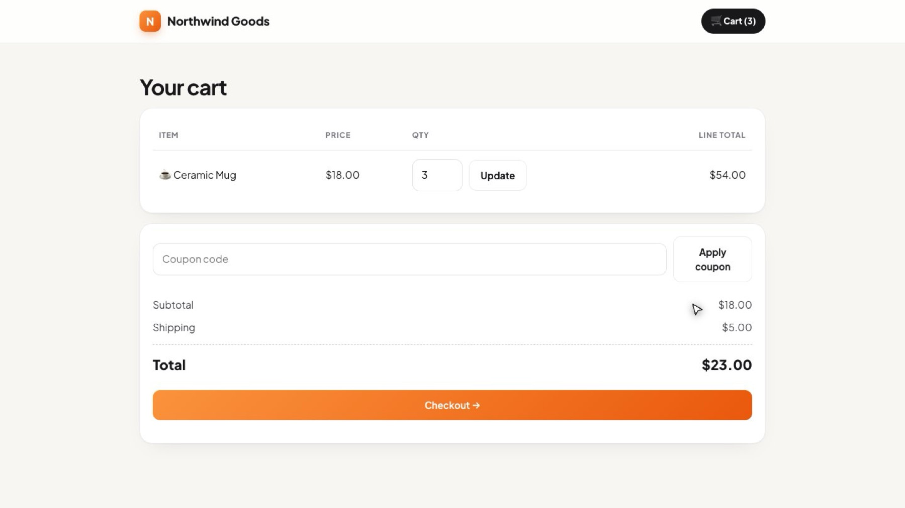
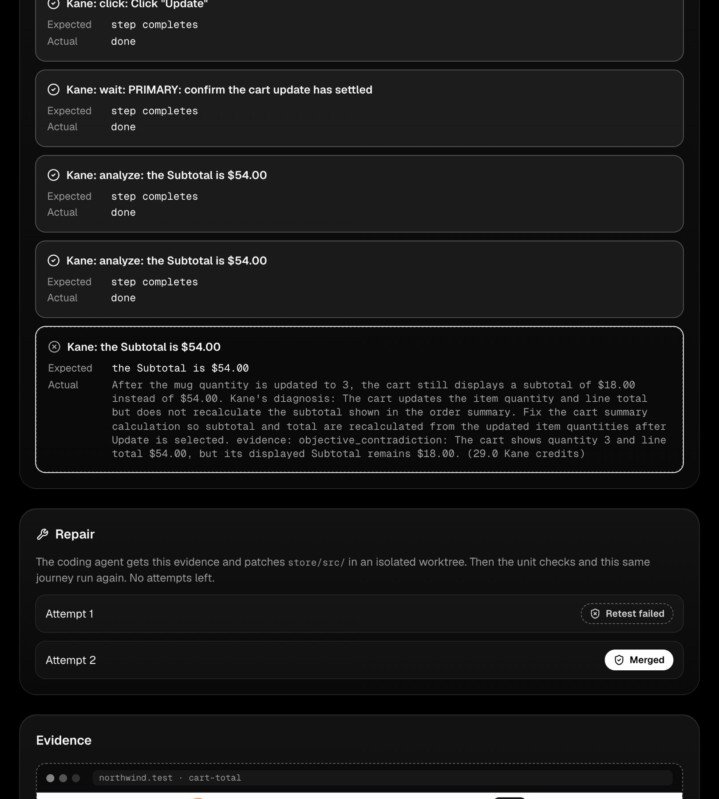
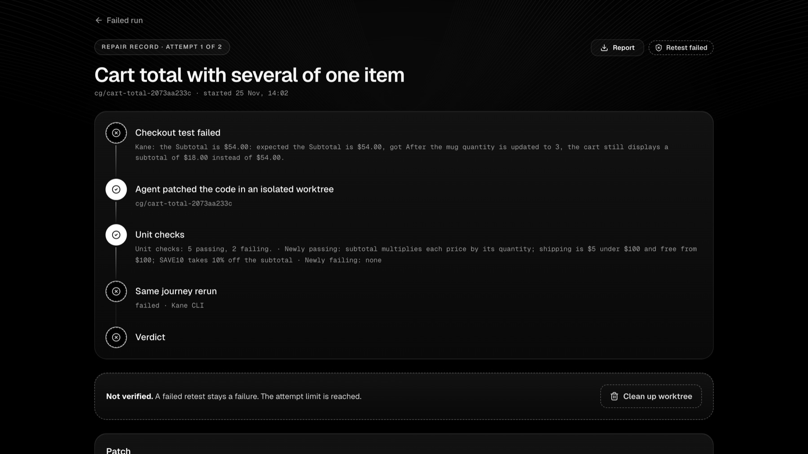
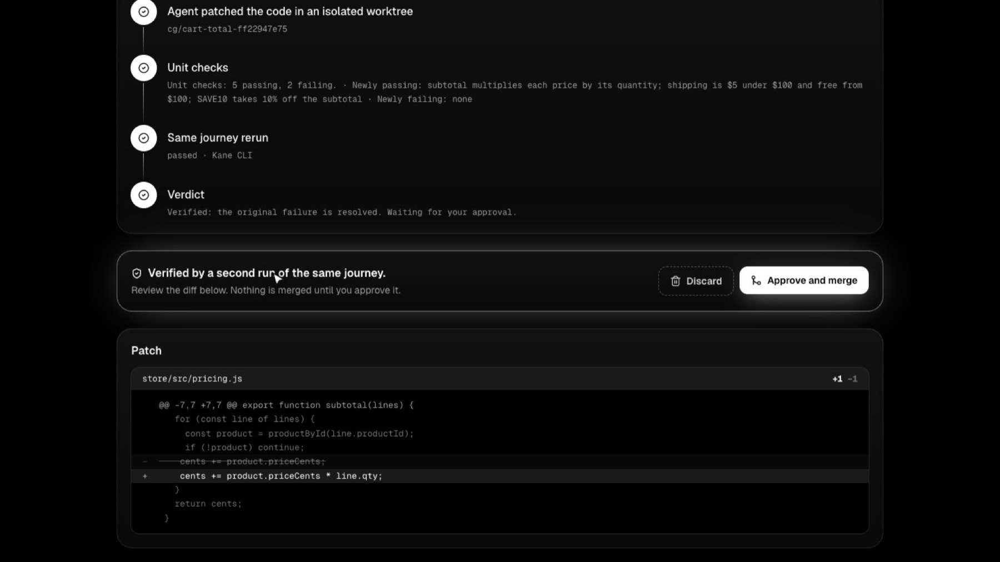
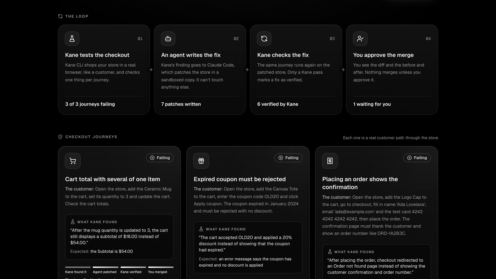
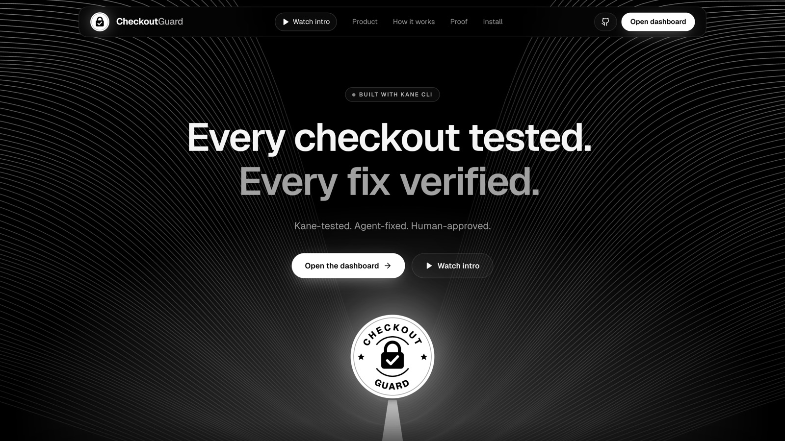

<div align="center">



# CheckoutGuard

### A coding agent's checkout fix only counts when a real browser agrees.

**Kane CLI** tests your checkout in real Chrome · a **coding agent** fixes what breaks · **Kane reruns the same journey** to decide if the fix counts · **you** approve the merge.

[](https://www.testmuai.com/support/docs/kane-cli-introduction/)
[](https://claude.com/claude-code)
[](#-proven-on-real-kane-cli-runs)

**[🌐 Live site](https://checkoutguard-eight.vercel.app)** · **[📝 Write-up](https://checkoutguard-eight.vercel.app/blog)** · **[🎞 Deck](https://checkoutguard-eight.vercel.app/deck)** · **[📄 Kane run report](https://checkoutguard-eight.vercel.app/evidence/kane-cart-total-live.html)** · **[▶ Run it](#-run-it)**

*Built for the KaneCLI Hackathon by TestMu AI.*

</div>

---

## 💸 The problem

A broken checkout costs a sale **every single time** it happens, and it's exactly the kind of bug that ships: unit tests pass, review looks fine, and nobody clicks through the whole journey. Coding agents make it worse. They say *"done"* when the tests they can see pass, and nothing ever loads the cart in a real browser.

**CheckoutGuard puts Kane CLI in charge of the verdict.** The agent writes the fix; Kane decides whether it worked.

## 🔁 The loop



| | Step | What happens |
|---|---|---|
| 1 | **Kane tests** | Each journey is a plain-English Kane objective ending in one assertion. `kane-cli run --agent` drives real Chrome. |
| 2 | **Evidence** | A `confirmed_product_bug` becomes a failure with Kane's finding, diagnosis, screenshots and network log. Kane's own errors are retried once and never sent for repair. |
| 3 | **Agent fixes** | Claude Code (or OpenCode) patches the store in a git worktree with **no shell and no web**. Touching tests or objectives gets the patch **rejected**. |
| 4 | **Unit gate** | No test that passed may fail, and at least one failing test must now pass. |
| 5 | **Kane reruns** | The same objective on the patched store. **Only a Kane pass marks the repair verified.** |
| 6 | **You approve** | Review the diff and Kane's before and after, then merge or discard. Nothing merges on its own. |

## 🎬 See it in action

A real run on the demo store, **Northwind Goods**.

**1. The bug.** Three mugs at $18 should cost $54. The line total is right; the subtotal isn't.



**2. Kane catches it**, step by step in real Chrome, with a diagnosis the agent can act on: *"The cart updates the item quantity and line total but does not recalculate the subtotal."*



**3. The rerun that didn't pass.** Claude Code's one-line fix was right, but Kane's first rerun failed on its own check. CheckoutGuard **refused to call it verified**. A failed rerun stays a failure.



**4. Verified by Kane.** With the assertion anchored to the totals row, attempt 2 passed Kane's rerun. Only then did it turn *Verified*, still waiting for a person to approve.



📄 **[Read the full Kane run report for this repair →](https://checkoutguard-eight.vercel.app/evidence/kane-cart-total-live.html)**

### The dashboard

Every journey shows what the customer does, what Kane found, and where its fix stands, with one button to start a repair.



## ✅ Proven on real Kane CLI runs

All three seeded bugs went round the full loop: **caught by Kane, fixed by Claude Code, verified by a Kane rerun.**

| Bug | ❌ What Kane CLI reported | ✅ Fix | Kane rerun |
|---|---|---|---|
| [Cart subtotal](docs/evidence/kane-cart-total.html) | "After the mug quantity changed to 3, the cart still displayed a subtotal of $18.00 instead of $54.00." | `subtotal()` multiplies by quantity | 🟢 passed |
| [Expired coupon](docs/evidence/kane-expired-coupon.html) | "The cart accepted OLD20 and applied a 20% discount instead of showing that the coupon had expired." | `checkCoupon()` checks the expiry date | 🟢 passed |
| [Order confirmation](docs/evidence/kane-order-confirmation.html) | "After placing the order, checkout redirected to an Order not found page instead of showing the customer confirmation and order number." | the confirmation page reads `?order=` | 🟢 passed |

The repair records (Kane's steps and diagnosis, the patch, the unit checks, the passing rerun) are in [`docs/evidence/`](docs/evidence/). The fixes were not kept on `main`, so the bugs stay seeded for anyone who wants to run the loop themselves. Each Kane run cost about 20 to 30 Kane credits.

## ▶ Run it

Requires **Node 22.5+** (built-in SQLite), **Google Chrome**, **[Kane CLI](https://www.testmuai.com/support/docs/kane-cli-introduction/)** and a coding agent (**[Claude Code](https://claude.com/claude-code)** or OpenCode).

```bash
npm install -g @testmuai/kane-cli && kane-cli login       # free testmuai.com account
git clone https://github.com/BernardOnuh/checkoutguard
cd checkoutguard/dashboard && npm install && npm run dev  # http://127.0.0.1:3100, dashboard at /app
```

Open **http://127.0.0.1:3100/app**, press **Run all journeys**, then **Fix it with the agent** on a failing one, and watch the repair record fill in live.

<details>
<summary><b>Command line</b></summary>

```bash
cd store && npm start                          # the demo store on http://127.0.0.1:4300 (optional, for browsing)
node runner/src/cli.js test all
node runner/src/cli.js repair <failureId>
node runner/src/cli.js approve <attemptId>     # or: discard <attemptId>
node runner/src/cli.js report <attemptId>      # a self-contained HTML repair report
node runner/src/cli.js status

cd runner && npm test                          # the loop's guarantees, and the Kane adapter on recorded Kane output
                                               # (no AI calls, no Kane credits)
```

`kane-cli config project <id>` and `kane-cli config folder <id>` set where Kane files its runs (once; otherwise the first run picks defaults).
</details>

<details>
<summary><b>Settings</b></summary>

| Variable | Default | |
|---|---|---|
| `CG_TESTER` | `kane` when `kane-cli` is installed | `local` uses a free stand-in headless-Chrome check, labelled *Local check* everywhere and never shown as Kane evidence |
| `CG_KANE_TIMEOUT_S` | `300` | Kane run time limit |
| `CG_AGENT` | `claude` if installed, else `opencode` | `patch:<file>` applies a hand-written patch instead (development only, labelled in the log) |
| `CG_MAX_ATTEMPTS` | `2` | Repair attempts per failure |
| `CG_AGENT_TIMEOUT_MS` | `600000` | Agent time limit |
| `CG_DATA_DIR` | `data/` | Run history (SQLite) and evidence |
| `CG_ROOT` | repo root | Repository to test and repair |
</details>

<details>
<summary><b>The demo store's seeded bugs</b></summary>

| Scenario | Bug |
|---|---|
| `cart-total` | The subtotal ignores quantity: 3 mugs show $18.00 instead of $54.00 |
| `expired-coupon` | The expired code `OLD20` is accepted |
| `order-confirmation` | After paying, the confirmation page says "Order not found" (it reads `?id=`, checkout sends `?order=`) |
</details>

<details>
<summary><b>Data model</b></summary>

`projects` → `test_runs` (scenario, runner, target, status, steps) → `failures` (step, expected, actual, evidence) → `repair_attempts` (branch, worktree, diff, agent log, unit log, status) → `verifications` (rerun, verdict).
</details>

More: [architecture](docs/ARCHITECTURE.md) · [demo script](docs/DEMO.md) · [submission notes](docs/SUBMISSION.md)

## 🔒 Safety

- **Nothing is ever charged.** Payments use a fake provider that accepts only the test card 4242 4242 4242 4242.
- **The agent is boxed in.** Temporary git worktrees, no shell, no web, and patches outside `store/src/` are rejected.
- **A person decides.** Attempts are capped at 2, the original failure's evidence is kept, and merging always needs approval. Nothing deploys automatically.
- **The runner stays local.** It runs code and git commands, so the dashboard only accepts requests from this machine. The [public site](https://checkoutguard-eight.vercel.app) serves the homepage, write-up, deck and evidence only.

## 🗺 What's next

- The loop on every pull request, in CI
- More journeys: mobile, payment edge cases, API calls inside objectives
- Kane tests committed and replayed

<div align="center">
<br/>


**Every checkout tested. Every fix verified.**

</div>
